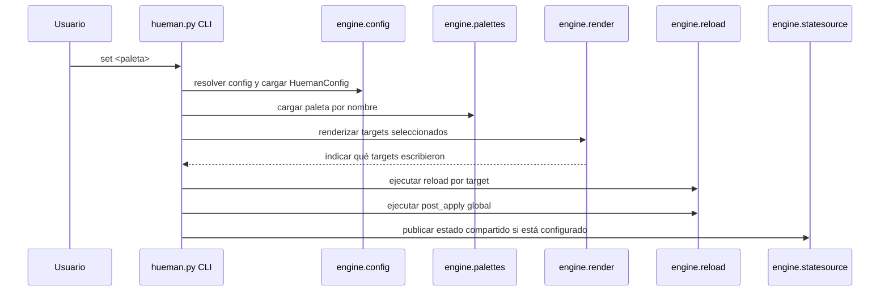
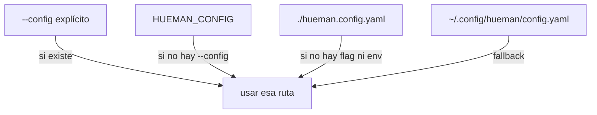
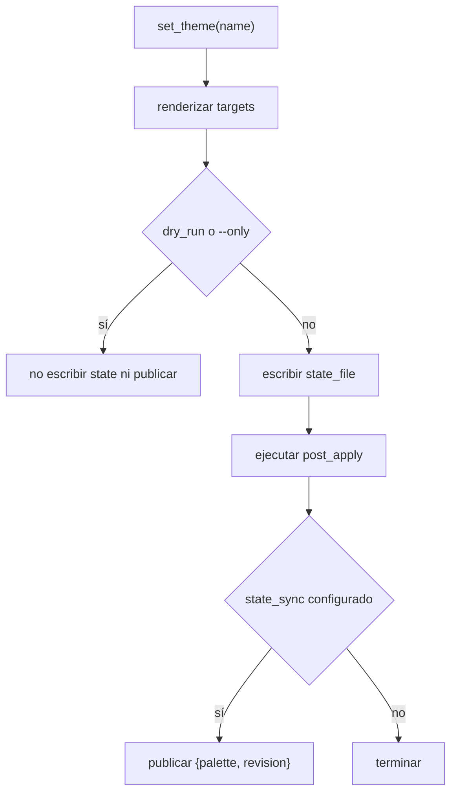
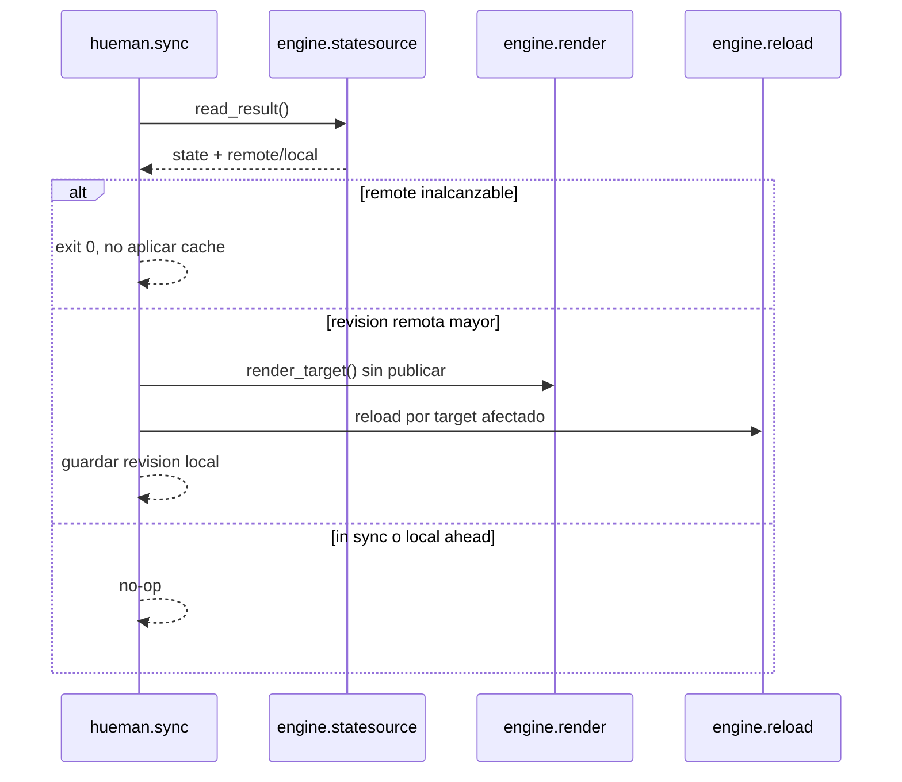

# Architecture overview

`hueman` es un motor de temas autocontenido. Su responsabilidad no es “adivinar” el entorno de dotfiles, sino tomar una configuración explícita, cargar una paleta por nombre, renderizar uno o más targets, ejecutar recargas asociadas y, de forma opcional, publicar o consumir un estado compartido.

La idea central de la arquitectura es separar cuatro preocupaciones:

1. **Entrada y resolución de configuración**: `hueman.py` arranca la CLI y `engine/config.py` decide qué archivo `hueman.config.yaml` usar.
2. **Modelo declarativo**: `engine/targets.py` traduce el YAML de config en `Target` y `PatchSpec`; `engine/palettes.py` hace lo mismo para las paletas YAML.
3. **Renderizado genérico**: `engine/render.py` implementa el motor común para `overwrite` y `patch`; no hay código Python por herramienta.
4. **Estado y sincronización**: `engine/statesource.py` abstrae el backend de estado compartido, mientras que `Hueman.set_theme()` y `Hueman.sync()` coordinan escritura, publicación y aplicación.

## Flujo en tiempo de ejecución

La CLI expone tres caminos principales: `set`, `sync` y `status`. Todos pasan por la misma configuración y comparten el mismo cargador de paletas, pero cada uno usa una parte distinta del motor.

Este flujo deja claro que el motor renderiza primero y solo después dispara acciones secundarias. Si un target no escribe nada, su `reload` no corre. Si hay `post_apply`, se ejecuta una sola vez al final del `set` completo.

## Resolución de configuración

La selección del config tiene una precedencia fija: `--config` gana sobre `HUEMAN_CONFIG`, que a su vez gana sobre `./hueman.config.yaml`; si ninguno existe, se usa `~/.config/hueman/config.yaml`.

La resolución vive en `HuemanConfig.resolve_path()`, mientras que el constructor de `HuemanConfig` valida el YAML una vez elegida la ruta. Si el archivo no existe, el CLI falla antes de intentar renderizar nada.

## Responsabilidades por módulo

### `hueman.py`: orquestación de alto nivel

`Hueman` es el coordinador del sistema. No conoce detalles de sintaxis de paletas ni de plantillas; solo conecta las piezas:

- mantiene una instancia de `PaletteLoader`;
- cachea entornos Jinja por delimitadores;
- selecciona targets aplicando `--only`;
- invoca `render_target()`;
- dispara `run_reload()` y `run_post_apply()`;
- administra el archivo de estado local y, si existe `state_sync`, la publicación o lectura del estado compartido.

Esto significa que `hueman.py` toma decisiones de orquestación, pero no implementa lógica específica de herramientas. Esa lógica está concentrada en datos de configuración y en el motor genérico de renderizado.

### `engine/config.py`: carga y validación del config

`HuemanConfig` carga el YAML del usuario y normaliza sus campos en estructuras listas para usar:

- `state_file`, `palette_dirs`, `template_dirs` y `post_apply`;
- `targets` mediante `load_targets()`;
- `state_sync` mediante `parse_settings()`;
- `logger` mediante un logger propio del proyecto.

Su responsabilidad es validar forma y tipos, no ejecutar el comportamiento del sistema. Si el config es inválido, el error es un `ConfigError` temprano.

### `engine/palettes.py`: búsqueda y precedencia de paletas

El cargador de paletas busca primero en los directorios custom del usuario y después en el árbol empaquetado. Eso permite sobrescribir una paleta empaquetada con otra del mismo nombre sin tocar el código del proyecto.

Cuando dos directorios definen la misma paleta, la de mayor precedencia gana y se emite un warning. Si una paleta no existe o el YAML es inválido, la carga falla de manera explícita.

### `engine/render.py`: motor genérico de salida

El renderizado está desacoplado de los targets concretos. El motor trabaja con dos estrategias:

- `overwrite`: renderiza una plantilla completa y la escribe en uno o más destinos;
- `patch`: modifica contenido existente mediante `regex_splice` o `json_scheme_upsert`.

Además, `render.py` aporta el contexto Jinja común y filtros como `contrast` e `is_dark`. `Target` puede pedir variables extra de la paleta con `palette_key` y `extra_vars`; si faltan claves obligatorias, el target se omite con un error de render que sube como `TargetRenderError`.

### `engine/reload.py`: recarga y hooks

`reload.py` solo ejecuta comandos. Expande placeholders como `{name}` y `{seccion.clave}` con `shlex.quote`, preservando expresiones de shell como `${VAR}` y llaves sin punto.

La semántica es best-effort: un `reload` devuelve código de salida y el orquestador decide qué hacer con ese resultado según `reload_failure`. `post_apply` se ejecuta al final del `set` completo y no interrumpe automáticamente el resto de comandos si uno falla.

### `engine/statesource.py`: backend de estado compartido

El estado compartido está detrás de la interfaz `StateSource`. `build_source()` instancia el backend correcto a partir de `state_sync.type`.

Hoy hay dos implementaciones:

- `GitBranchSource`, que publica `{palette, revision}` en una rama huérfana del remoto usando un repo privado bajo el estado de XDG;
- `FileSource`, que escribe el mismo YAML en un archivo de una carpeta sincronizada por otra herramienta.

Ambas implementaciones cumplen el mismo contrato: no deben colgar, deben degradar a “inalcanzable” en vez de lanzar, y deben resolver conflictos por revisión creciente. Eso permite que `set`, `sync` y `status` usen el mismo modelo sin conocer el backend concreto.

## Estado local y sincronización

`set_theme()` escribe el archivo de estado local solo cuando el cambio es real y completo, no en `--dry-run` ni en `--only`. Ese archivo guarda solo el nombre de la paleta; la revisión compartida vive en `<state_file>.revision` para no romper el formato legado.

La publicación del estado compartido es intencionalmente best-effort: si el backend no está disponible, `set` sigue aplicando la paleta local y solo registra una advertencia. Esto evita que un problema de sincronización rompa la aplicación del tema.

`sync()` invierte el sentido del flujo: primero consulta el backend, luego compara revisiones y solo aplica la paleta remota si es más nueva que la local. Si el remoto es inalcanzable o no hay estado remoto, no escribe nada y retorna un resultado no fatal.

Hay dos invariantes importantes aquí:

- `sync` nunca debe aplicar una caché local cuando el remoto está inalcanzable.
- `sync` no publica una revisión nueva; solo consume el estado compartido.

## Límites entre módulos

El diseño hace que cada módulo tenga una responsabilidad claramente acotada:

- **Config** decide qué existe y si es válido.
- **Palettes** decide qué paleta se carga y desde dónde.
- **Render** decide cómo producir bytes para los outputs.
- **Reload** decide cómo ejecutar comandos externos.
- **StateSource** decide cómo persistir o recuperar el estado compartido.
- **Hueman** decide cuándo componer esas piezas.

Esa separación reduce el acoplamiento entre temas, herramientas y backend de sincronización. En particular, agregar una nueva herramienta suele requerir solo una nueva entrada declarativa en `targets` y, si hace falta, una plantilla; no hace falta extender el motor en Python.

## Puntos de extensión

Los puntos pensados para extender el sistema son:

- `palette_dirs` para añadir paletas propias sin tocar las empaquetadas;
- `template_dirs` para sobrescribir o añadir templates;
- `targets` para declarar nuevas salidas y comandos de recarga;
- `state_sync.type` para cambiar el backend de sincronización dentro del contrato de `StateSource`.

El contrato del backend es especialmente importante: cualquier implementación nueva debe mantener el comportamiento de revisión monotónica, tiempo acotado y degradación segura ante fallos.

## Qué mirar en pruebas

Las pruebas más útiles para entender la arquitectura son las que ejercitan integración entre módulos, no solo unidades aisladas:

- el contrato de `StateSource`, que verifica alcance, idempotencia, control de revisiones y comportamiento ante indisponibilidad;
- las pruebas de `sync` y `status`, que muestran cuándo se aplica la paleta remota, cuándo se hace no-op y cómo se reporta el drift;
- las pruebas de targets y render, que confirman que el `reload` solo ocurre tras una escritura real y que los fallos de claves ausentes no rompen todo el proceso.

En conjunto, esas pruebas fijan la forma real del sistema: un orquestador pequeño, un renderizador genérico y un backend de estado intercambiable.
