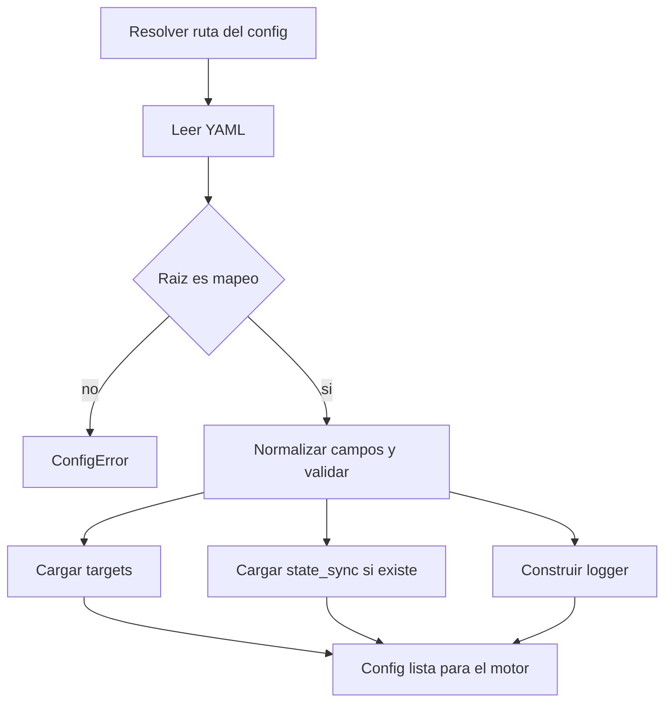

# Modelo de configuración

`hueman.config.yaml` es el punto de entrada para adaptar el motor a cada repo de dotfiles. El archivo describe dónde guardar el estado local, qué paletas y templates añadir, qué targets renderizar, qué hacer cuando un comando de recarga falla y, de forma opt-in, si el tema activo debe sincronizarse como estado compartido.

La configuración la consume `engine/config.py` y el resto del motor trabaja a partir de esa estructura ya validada. No existe descubrimiento dinámico de máquinas, entornos ni rutas de salida: todo eso se expresa explícitamente en el config.

## Resolución del archivo de configuración

La ruta efectiva se resuelve con esta precedencia:

1. `--config RUTA`
2. variable de entorno `HUEMAN_CONFIG`
3. `./hueman.config.yaml` en el directorio actual, si existe
4. `~/.config/hueman/config.yaml`

La lógica está en `HuemanConfig.resolve_path()`. El test `test_resolve_path_precedence` confirma que el argumento explícito gana sobre la variable de entorno, y que el archivo del directorio actual gana cuando no hay `HUEMAN_CONFIG`.

## Estructura general del YAML

La raíz debe ser un mapeo YAML. Si el archivo no parsea o la raíz no es un objeto, se rechaza con `ConfigError`.

Campos observados en el código:

- `state_file`: opcional, ruta donde se guarda el nombre de la paleta activa.
- `palette_dirs`: opcional, lista de directorios extra con paletas YAML.
- `template_dirs`: opcional, lista de directorios extra con templates Jinja2.
- `targets`: obligatorio, mapeo de nombre de target a definición.
- `reload_failure`: opcional, política global ante fallos de `reload` o `post_apply`.
- `post_apply`: opcional, lista de comandos globales al final de un `set` completo.
- `state_sync`: opcional, configuración de estado compartido.
- `logging`: opcional, ajustes del logger `hueman`.

Ejemplo mínimo, basado en el archivo de muestra del repositorio:

```yaml
state_file: "~/.config/hueman/current"
palette_dirs:
  - "~/dotfiles/theme/palettes.custom"
template_dirs:
  - "~/dotfiles/theme/templates.custom"
reload_failure: warn
targets:
  kitty:
    template: kitty.conf.j2
    palette_key: kitty
    mode: overwrite
    outputs:
      - "~/.config/kitty/theme.conf"
```

## Validación y defaults

`HuemanConfig` aplica validación inmediata al cargar:

- la raíz debe ser un mapeo YAML;
- `targets` debe ser un mapeo de `nombre -> definición`, y cada definición debe ser un mapeo;
- `reload_failure` solo acepta los valores soportados por `FAILURE_POLICIES`, observados como `warn` y `error`;
- `state_sync` se delega a `parse_settings()`, y los errores se reenvían como `ConfigError`.

Defaults observados en código y ejemplo:

- `state_file` por defecto: `~/.config/hueman/current`
- `reload_failure` por defecto: `warn`
- `state_sync` ausente: no se activa la sincronización de estado
- `logging.level` por defecto: `INFO`

La carga de `HuemanConfig` también normaliza rutas con `Path(...).expanduser()` para `state_file`, `palette_dirs`, `template_dirs` y el archivo de logs.

## Prioridad de paletas y templates

`palette_dirs` y `template_dirs` amplían el material empaquetado dentro del repositorio sin reemplazarlo. El comportamiento relevante es:

- las paletas empaquetadas se buscan primero desde el árbol del proyecto;
- las rutas custom se añaden después;
- si un nombre de paleta existe en ambos sitios, la custom gana.

El test `test_palette_custom_precedes_packaged` cubre esa precedencia: `shared.yaml` en un directorio custom sobrescribe al empaquetado con el mismo nombre, mientras que cada origen conserva sus entradas únicas.

Para templates, el diseño es análogo: los directorios custom se usan como extensión del set empaquetado. El smoke test `test_real_config_has_targets` y `test_real_target_template_exists_and_renders` confirman que un config real debe poder resolver sus templates contra los empaquetados; si un target usa `template_dirs`, eso sirve para aportar templates adicionales, no para romper los ya incluidos.

## Targets

`targets` es el núcleo del archivo. Cada target declara cómo se renderiza y qué outputs afecta.

Propiedades importantes observadas en los ejemplos y tests:

- `template`: nombre del template Jinja2 para targets de overwrite.
- `mode`: modo de render; el ejemplo muestra `overwrite` y `patch`.
- `palette_key`: sección de la paleta que alimenta al target.
- `outputs`: lista explícita de rutas de salida.
- `reload`: comando a ejecutar después de escribir el target, si corresponde.
- `patch`: bloque de configuración para targets que modifican parcialmente un archivo existente.
- `skip_if_missing_parent`: guarda opcional para omitir outputs cuyo directorio padre no existe.
- `skip_unless_path_exists`: guarda opcional para omitir el target entero si faltan rutas requeridas.
- `reload_failure`: override opcional por target.

La validación de `targets` ocurre en `load_targets()`. Si la definición no es coherente, `HuemanConfig` la convierte en `ConfigError`.

### Guardas de salida

El ejemplo documenta dos mecanismos de exclusión:

- `skip_if_missing_parent: true` omite una salida concreta si su directorio padre no existe.
- `skip_unless_path_exists` acepta una ruta o una lista de rutas; si alguna falta, el target entero se omite sin escribir ni disparar `reload`.

Esto permite expresar dependencia de instalaciones o rutas del sistema sin introducir lógica condicional fuera del config.

## Política de `reload_failure`

La política global determina qué hace hueman cuando un `reload` o `post_apply` devuelve un código distinto de cero.

Valores soportados:

- `warn` — registra advertencia y `set` termina con éxito;
- `error` — registra error, continúa con el resto de pasos en modo best-effort y `set` termina con exit 1.

Un target puede sobrescribir esa política con su propio `reload_failure`. El README y el ejemplo muestran también que el código de salida de cada comando se registra siempre.

## `post_apply`

`post_apply` es una lista de comandos globales que corre una sola vez al final de un `set` completo. No corre en `set --only`, porque ese modo se considera un re-render parcial.

Los comandos de `reload` y `post_apply` aceptan placeholders como:

- `{name}` o `{palette}`
- `{seccion.clave}` para leer valores de la paleta activa

Los valores se sustituyen ya escapados con `shlex.quote`. Un placeholder con punto que no exista aborta con error claro; por el contrario, `${VAR}` y llaves sin punto permanecen intactas.

## `state_file`

`state_file` persiste el nombre de la paleta activa en una sola línea. El archivo se escribe solo en un `set` completo y real:

- no se escribe en `--dry-run`
- no se escribe en `--only`

`status` y los placeholders que usan `{name}` leen ese valor.

## Estado compartido opt-in (`state_sync`)

La sincronización de estado es opt-in: si `state_sync` no aparece, no hay publicación remota.

El ejemplo del repositorio describe dos backends detrás de `StateSyncConfig` y `StateSource`:

- `git` — backend por defecto
- `file` — archivo compartido en una carpeta sincronizada por otra herramienta

El backend se selecciona con `state_sync.type`; si se omite, `git` sigue siendo el valor por defecto. En el caso `git`, el estado se publica como `{palette, revision}` en una rama huérfana `hueman-state` usando un repo git propio bajo `$XDG_STATE_HOME/hueman/`, sin tocar el working tree del usuario. En el caso `file`, la misma información se escribe de forma atómica en un archivo, y la carpeta destino debe existir previamente.

El comportamiento operativo relevante es que `set --dry-run` y `set --only` no escriben ni empujan estado compartido.

## Logging

`_make_logger()` crea o reutiliza el logger `hueman`.

Detalles observables:

- nivel configurable con `logging.level`, por defecto `INFO`;
- si no hay handlers previos, añade un `StreamHandler` con formato simple;
- si `logging.file` está presente, añade además un `FileHandler` con timestamp.

Esto hace que la configuración de logs sea parte del mismo archivo que define el resto del comportamiento del motor.

## Flujo de carga



La configuración se valida al cargar; si algo es incoherente, se falla antes de renderizar o escribir archivos.

## Relación con otras partes del sistema

- El modelo de targets y renderizado se describe en [Targets and rendering](../concepts/targets-and-rendering.md).
- El estado compartido y su sincronización se tratan en [State sync](../concepts/state-sync.md).
- El comportamiento en runtime y ante fallos de reload queda coordinado con las reglas operativas de [Runtime and failure handling](../operations/runtime-and-failure-handling.md).

## Tests que fijan el contrato

Los tests más relevantes para esta página son:

- `tests/test_config_and_palettes.py::test_resolve_path_precedence` — precedencia de resolución del archivo de config.
- `tests/test_config_and_palettes.py::test_palette_custom_precedes_packaged` — prioridad de paletas custom sobre las empaquetadas.
- `tests/test_config_and_palettes.py::test_config_loads_paths_and_targets` — carga de `state_file`, `palette_dirs` y `targets`.
- `tests/test_real_config.py::test_real_target_template_exists_and_renders` — el config real debe apuntar a templates resolubles y renderizables.

En conjunto, estos tests fijan la parte más importante del contrato: la configuración es declarativa, se valida al cargar y define de forma explícita qué recursos del repositorio y del entorno serán usados por el motor.
