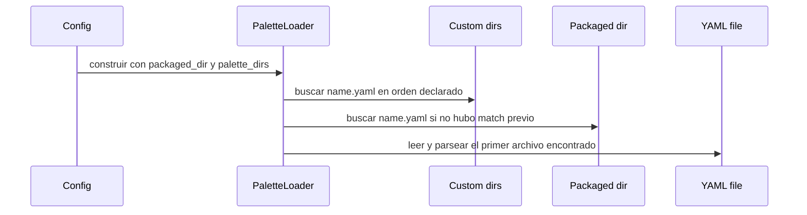

# Palette model and lookup

hueman trata cada paleta como un archivo YAML cuyo nombre base es el nombre
público de la paleta. El motor no descubre paletas por contenido ni por
metadatos externos: busca `*.yaml` en directorios conocidos, resuelve un único
archivo por nombre y luego exige que el YAML cargado sea un mapeo de nivel
superior.

## Dónde vive la fuente de verdad

El cargador de paletas combina dos orígenes:

- paletas empaquetadas dentro del árbol del proyecto, y
- directorios `palette_dirs` declarados por el usuario en el config.

La precedencia es fija: primero se consultan los directorios custom, en el orden
listado en el config, y después el directorio empaquetado. Eso significa que una
paleta custom con el mismo nombre que una empaquetada la reemplaza de facto.

El cargador no fusiona contenidos de varios archivos con el mismo nombre. Se
queda con el primero que encuentra según la precedencia anterior.

## Resolución de nombres y conflictos

`list_palettes()` enumera los nombres disponibles combinando todos los directorios
buscados y devolviendo la lista ordenada de nombres únicos. Si un mismo nombre
aparece en más de un directorio, el loader mantiene la versión de mayor
precedencia y emite un warning indicando que la paleta duplicada fue ignorada.

`load(name)` usa la misma precedencia para resolver el archivo efectivo. Si la
paleta existe en más de un sitio, no hay error: gana el primer match. Si no
existe en ningún directorio, el motor falla con exit 1 y loguea el nombre
pedido junto con la lista de disponibles.

## Invariantes del YAML

Después de encontrar el archivo, el loader lo parsea con `yaml.safe_load`.
Hay dos invariantes observables:

1. el YAML debe ser sintácticamente válido, y
2. el resultado debe ser un `dict` en la raíz.

Cualquier violación se considera un error fatal de configuración: el loader
registra el problema y termina el proceso con `SystemExit(1)`. Esto evita que el
resto del motor trabaje con una estructura ambigua o parcial.

## Contrato para quien consume paletas

El resto del motor ve una paleta ya resuelta como un diccionario YAML. En la
práctica, eso habilita lookup por claves de primer nivel y por rutas con punto
usadas por los templates y hooks del sistema. La responsabilidad del loader es
solo entregar una estructura válida y una fuente inequívoca; no interpreta el
semántico de las claves de la paleta.

## Fallos que importan operativamente

Los fallos relevantes son simples y predecibles:

- nombre inexistente: el comando aborta con exit 1;
- YAML inválido: el comando aborta con exit 1;
- raíz que no es mapeo: el comando aborta con exit 1;
- nombre duplicado: no aborta, pero la versión custom o de mayor precedencia
  eclipsa a las demás y se informa por log.

## Relación con la configuración

La configuración de usuario solo aporta los directorios custom. Los ejemplos de
`hueman.config.example.yaml` muestran la intención operativa: si una paleta
custom comparte nombre con una empaquetada, la custom gana. Esa es la forma
prevista de sobrescribir temas sin tocar el árbol empaquetado.

## Tests representativos

La semántica está cubierta por tests que verifican tres cosas: que el config
resuelve caminos en el orden esperado, que una paleta custom precede a la
empaquetada cuando el nombre colisiona, y que un nombre inexistente termina con
`SystemExit(1)` mientras reporta las paletas disponibles.

En conjunto, el contrato observable es: directorios custom primero, empaquetado
después, un único archivo efectivo por nombre, y rechazo estricto de YAML
malformado o de raíz no mapearia.
