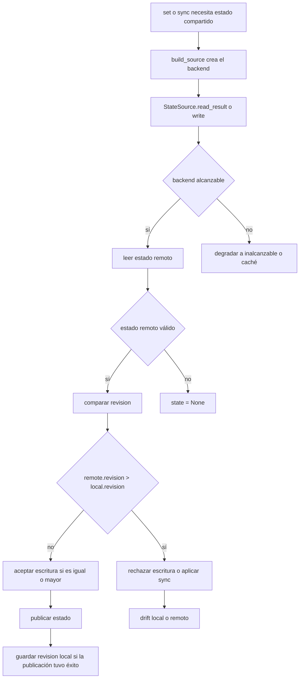

# Shared state sync

`state_sync` es un mecanismo opt-in para compartir la paleta activa entre
máquinas o sesiones. Guarda y recupera un estado pequeño `{palette, revision}`
que se publica mediante una interfaz abstracta, no mediante un backend fijo.
El motor depende de `StateSource` y de `build_source(...)`; eso le permite
trabajar con `git` o `file` sin conocer sus detalles internos.

## Modelo de estado

El estado compartido usa la dataclass `State`:

- `palette`: nombre de la paleta activa.
- `revision`: entero monótono que ordena escrituras y resuelve conflictos.

La semántica de `revision` es la pieza clave del diseño:

- una `revision` mayor domina a una menor;
- si dos escrituras compiten con la misma `revision`, gana la escritura que se
  aceptó y publicó al final;
- si el almacenamiento remoto contiene una `revision` estrictamente mayor,
  una escritura más antigua se rechaza sin sobrescribir.

Esto permite reconciliar copias locales, remotos y estados de sincronización
sin introducir un protocolo de merge más complejo.

## Alcanzable e inalcanzable

La interfaz distingue entre dos clases de lectura:

- **alcanzable**: el backend pudo consultar el almacén compartido. En ese caso
  `ReadResult.remote = True`, aunque el almacén esté vacío o el contenido no se
  pueda interpretar.
- **inalcanzable**: el backend no pudo llegar al almacén por falta de
  configuración, ausencia del directorio compartido, remoto caído, error de I/O
  o timeout. En ese caso `ReadResult.remote = False`.

La consecuencia operativa es importante:

- un resultado alcanzable puede devolver `state = None` si el almacén está vacío
  o si el contenido no es parseable;
- un resultado inalcanzable puede incluir caché local en algunos backends, pero
  los consumidores no deben aplicarla como verdad remota;
- `write()` solo devuelve `True` cuando el estado quedó publicado o ya era el
  estado compartido exacto.

## Interfaz `StateSource`

`StateSource` es la abstracción que usa el motor para leer y publicar estado.
Su contrato, reforzado por pruebas compartidas entre backends, exige:

- no lanzar excepciones hacia el llamador ante fallos de backend;
- acotar el tiempo de bloqueo de cada operación;
- aplicar la regla de `revision` monotónica con desempate por última escritura
  aceptada.

`read_result()` devuelve tanto el estado como la marca de alcanzable.
`read()` es un atajo que devuelve solo `state`. `write(state)` intenta publicar
un estado nuevo y devuelve un booleano de éxito.

La arquitectura depende de esta interfaz, no de una implementación concreta.
Eso significa que el orquestador puede seguir funcionando aunque el backend sea
`git` o `file`, y que los tests de contrato puedan ejecutarse contra cada
backend registrado.

## Backends soportados

### `git`

El backend por defecto persiste el estado en una rama huérfana llamada
`hueman-state`.

Características relevantes:

- usa un repositorio git propio, separado del repo de dotfiles del usuario;
- no toca el working tree del repo de dotfiles;
- obtiene la URL remota desde el repo del usuario y trabaja contra una copia
  privada en el área de estado;
- publica el estado como un único commit reescrito con `commit-tree` y
  `push --force-with-lease`.

Cuando el remoto no está disponible, el backend degrada a inalcanzable y evita
romper el flujo local.

### `file`

El backend `file` guarda el mismo YAML `{palette, revision}` en un archivo
ubicado dentro de una carpeta que ya sincroniza otra herramienta, por ejemplo
Syncthing o Dropbox.

Características relevantes:

- la escritura es atómica;
- si la carpeta padre no existe, el backend la trata como inalcanzable y no la
  crea;
- no hay bloqueo distribuido;
- la resolución final de conflictos sigue la misma regla de `revision` mayor.

## Ciclo de lectura y escritura

El ciclo muestra dos momentos distintos:

1. **Escritura**: `set` construye el backend, calcula una `revision` nueva y
   publica el estado si el backend lo acepta.
2. **Lectura / sync**: `sync` consulta el estado remoto y lo aplica solo si la
   `revision` remota es mayor que la local.

## Drift local y remoto

El estado local y el remoto pueden divergir:

- **in sync**: ambas `revision` coinciden;
- **behind**: la local está por detrás y `sync` puede aplicar el estado remoto;
- **ahead**: la local está por delante y no se sobreescribe;
- **no remote state**: el backend es alcanzable pero todavía no hay estado;
- **remote unreachable**: no se puede confiar en el dato remoto, aunque un
  backend pueda mostrar una caché local.

La distinción entre `behind` y `ahead` se calcula únicamente con `revision`.
Eso evita comparar nombres de paleta como si fueran autoridad de sincronización.

## Flujo operativo

- `set` publica el tema activo y, si la publicación tiene éxito, persiste la
  nueva `revision` local.
- `sync` baja el estado compartido y lo aplica solo cuando el remoto está más
  nuevo.
- `status` reporta la `revision` local, la remota y el tipo de drift.

Cuando el backend está inalcanzable, el sistema prefiere seguir funcionando en
local antes que abortar el arranque del shell.

## Configuración

La configuración se define con `state_sync` y elige backend por tipo:

- `type: git` es el valor por defecto;
- `type: file` activa el archivo compartido;
- `repo`, `remote`, `branch`, `workdir` y `timeout` pertenecen al backend git;
- `path` pertenece al backend file.

Un tipo desconocido es un error de configuración. Los tests de contrato y de
integración verifican que la carga de configuración, la lectura, la escritura y
el drift se comporten igual en los backends registrados.

## Invariantes y fallos

- el estado compartido nunca debe bloquear el uso local de hueman;
- una lectura inalcanzable nunca debe aplicarse como verdad remota;
- una escritura con `revision` menor nunca debe sobrescribir una mayor;
- una escritura idéntica debe ser idempotente;
- la sincronización debe ser segura para el arranque del shell y mantenerse
  acotada por timeout.

## Pruebas que importan

Las pruebas relevantes cubren tres capas:

- **contrato abstracto**: el backend satisface el comportamiento común de
  `StateSource`;
- **backend git**: la rama huérfana, el commit único, la no interferencia con el
  repo de dotfiles y la reconciliación por `revision`;
- **backend file y orquestación**: lectura/escritura atómica, carpeta ausente
  como inalcanzable, persistencia de `revision` local y cálculo del drift en
  `sync`/`status`.

En conjunto, esas pruebas aseguran que el motor depende de la interfaz y no de
un almacenamiento concreto.
