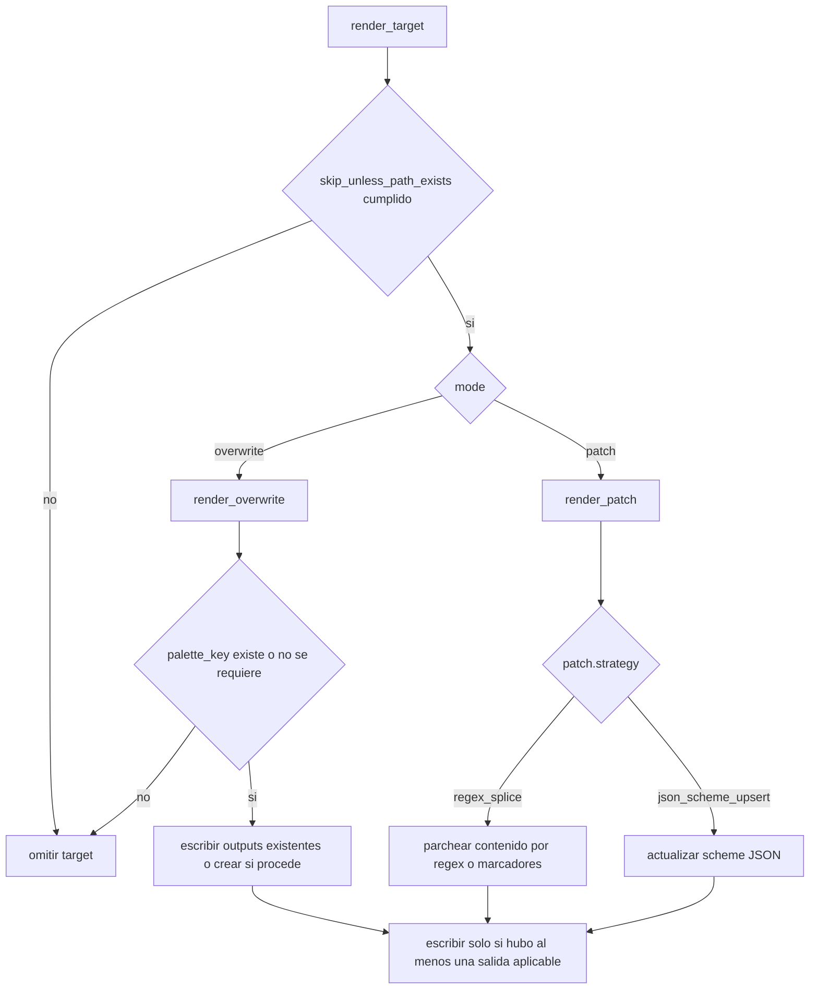
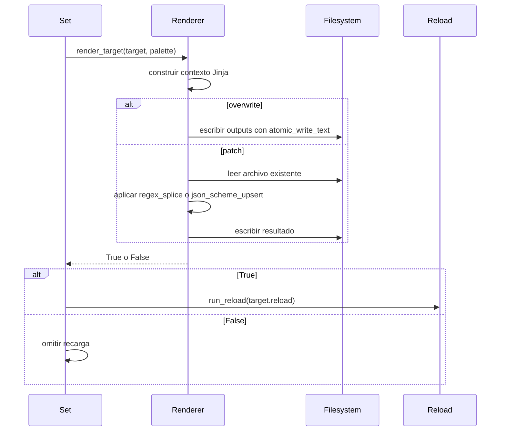

# Targets and rendering

Esta página describe cómo hueman convierte una definición declarativa de target en archivos escritos en disco y, cuando corresponde, en comandos de recarga. El diseño central es que **no hay lógica Python específica por herramienta**: cada target declara plantilla, paleta, salidas, modo y guardas, y el motor comparte el mismo flujo para todos.

## Qué es un target

Un `Target` reúne la información necesaria para producir uno o más outputs:

- `name`: identificador del target.
- `mode`: `overwrite` o `patch`.
- `template`: template Jinja2 usado para generar el contenido nuevo.
- `palette_key`: sección de la paleta que alimenta el contexto del template.
- `outputs`: lista explícita de rutas destino.
- `reload`: comando opcional que se ejecuta después de escribir.
- `reload_failure`: política local para el error del `reload`.
- `make_executable`: si el archivo escrito debe quedar ejecutable.
- `skip_if_missing_parent`: omite salidas cuyo directorio padre no existe.
- `skip_unless_path_exists`: omite todo el target si falta alguna ruta requerida.
- `jinja_delimiters`: delimitadores alternativos para el template.
- `extra_vars`: valores adicionales para el contexto Jinja.
- `patch`: especificación del parche cuando el modo es `patch`.

La carga de estos datos es puramente declarativa; `Target.from_dict()` normaliza rutas, convierte valores escalares a listas cuando corresponde y valida `reload_failure` contra las políticas soportadas.

## Cómo se construye el contexto Jinja

El render de templates se hace con `make_jinja_env()` y `build_context()`:

- el entorno Jinja usa un `ChoiceLoader`, primero con los `template_dirs` del usuario y después con el directorio empaquetado;
- si se pasan `jinja_delimiters`, el entorno usa esos delimitadores en lugar de `{{` y `}}`;
- se registran dos filtros, `contrast` e `is_dark`, para tareas de color;
- el contexto base siempre incluye `theme_name` con el nombre activo del tema.

Luego el contexto se amplía en dos pasos:

1. si el target define `palette_key` y esa sección existe en la paleta, el diccionario de esa sección se mezcla directamente en el contexto; por eso un template puede usar claves como `background` o `color4` sin prefijo adicional;
2. cada entrada de `extra_vars` se resuelve como lookup con punto sobre la paleta completa, por ejemplo `kitty.color4`, y el valor se inserta bajo la clave destino que indique el mapa.

Si un `extra_vars` no se puede resolver, el render falla con un error de clave. En cambio, si el target tiene `palette_key` pero esa sección no está presente, el target no se renderiza: se omite sin escribir ni recargar.

## Modos de render

En ambos modos, el motor devuelve un valor booleano que indica si realmente se produjo alguna escritura. Ese valor es importante porque el `reload` de un target solo debe dispararse cuando al menos una salida fue escrita.

## Modo `overwrite`

`render_overwrite()` genera una vez el contenido del template y lo escribe en todas las rutas de `outputs`.

Comportamiento relevante:

- si el target requiere `palette_key` y la sección no existe en la paleta, retorna `False` sin escribir;
- si `skip_if_missing_parent` está activo y el directorio padre no existe, esa salida se omite;
- en escritura real, el motor crea el directorio padre si hace falta y usa escritura atómica;
- `make_executable` se pasa a la escritura atómica para conservar el bit de ejecución cuando el archivo lo necesita;
- en `dry_run`, se informa lo que se escribiría, pero no se crean archivos ni directorios.

El modo `overwrite` es el que cubre la mayor parte de los templates de configuración: el archivo destino se reemplaza por completo con la salida del template.

## Modo `patch`

`render_patch()` modifica archivos existentes en lugar de reemplazarlos por completo. Hay dos estrategias:

### `regex_splice`

Esta estrategia trabaja sobre contenido existente y usa una pieza generada por Jinja para sustituir o insertar bloques.

Hay dos variantes:

- `marker_regex`: el bloque gestionado se define con un patrón regular; si el patrón existe en el archivo original, se reemplaza una vez. Si no existe, puede insertarse después de una sección previa o al final del archivo.
- `marker_begin` / `marker_end`: el bloque se identifica con marcadores literales de inicio y fin; si ya existen, el contenido entre ellos se reemplaza, y si no, el bloque se añade al final.

Después del splice, se aplican dos postprocesamientos opcionales sobre el contenido ya parcheado:

- `replacements`: sustituciones literales en orden;
- `ensure_after`: reglas que insertan texto después de un ancla si falta un patrón determinado.

Estas dos etapas son datos de configuración, no lógica por target.

### `json_scheme_upsert`

Esta estrategia está pensada para archivos JSON que contienen una lista de schemes. El motor:

- lee el JSON existente;
- construye un scheme nuevo a partir de la sección de paleta indicada por `palette_section`;
- reemplaza el scheme con el mismo `name` si ya existía, o lo agrega si no;
- vuelve a serializar el archivo con indentación estable.

Si el archivo no es JSON válido, el render falla con `TargetRenderError`. Si el archivo no existe, el target se omite: el modo patch no crea outputs nuevos.

## Condiciones de omisión sin escribir ni recargar

Un target puede quedar omitido sin producir escritura ni `reload` en estas situaciones:

- falta alguna ruta listada en `skip_unless_path_exists`;
- el target usa `palette_key` y esa sección no existe en la paleta;
- en `overwrite`, todas las salidas quedan omitidas por `skip_if_missing_parent`;
- en `patch`, una salida no existe y el modo no está diseñado para crearla;
- en `patch`, una salida existente puede seguir omitiéndose si su directorio padre falta y `skip_if_missing_parent` está activo.

La regla operativa más importante es que el `reload` de un target solo corre cuando `render_target()` devuelve `True`, es decir, cuando realmente se escribió al menos una salida. Si todo fue omitido, el target termina sin recarga.

## Placeholders en comandos de recarga

Los comandos `reload` y `post_apply` comparten el mismo sistema de expansión:

- `{name}` y `{palette}` se sustituyen por el nombre del tema activo;
- `{seccion.clave}` hace lookup en la paleta activa;
- el valor expandido se cita con `shlex.quote`;
- `${VAR}` permanece intacto;
- llaves sin punto, como `find -exec {} +`, permanecen intactas;
- un placeholder con punto que no exista provoca error claro.

Esto permite construir comandos seguros sin romper sintaxis de shell ni expandir accidentalmente variables del entorno.

## Contrato de éxito y fracaso

El contrato observable es simple:

- `render_target()` devuelve `True` si se escribió al menos una salida;
- devuelve `False` si el target se omitió por guardas o por falta de datos requeridos;
- los errores de plantilla, de JSON inválido, de E/S o de claves ausentes se elevan como `TargetRenderError`;
- cuando la escritura falla, el archivo original no se altera y el error se reporta como fallo limpio del target.

Ese contrato permite que el llamador decida si ejecutar `reload` y cómo contabilizar el resultado global del `set`.

## Relación con la política de reload

La política de `reload_failure` no vive dentro del renderer, pero depende de su resultado. El flujo es: renderizar, revisar si hubo escritura real y, solo entonces, ejecutar el `reload` del target. Después, el motor que orquesta `set` decide si un fallo de recarga es advertencia o error según la política global o local.

## Tests que fijan el comportamiento

Los tests más representativos para este contrato son:

- `tests/test_render.py::test_overwrite_creates_parent_and_renders_template` — overwrite crea padres y escribe el template renderizado.
- `tests/test_render.py::test_overwrite_dry_run_does_not_create_output` — `dry_run` no crea archivos.
- `tests/test_render.py::test_overwrite_skips_missing_parent_when_configured` — `skip_if_missing_parent` omite salidas concretas.
- `tests/test_render.py::test_patch_replaces_marked_block_and_preserves_surrounding_text` — `regex_splice` por marcadores preserva el contexto alrededor.
- `tests/test_render.py::test_json_scheme_patch_upserts_scheme` — `json_scheme_upsert` reemplaza o agrega schemes.
- `tests/test_render.py::test_windhawk_taskbar_template_matches_legacy_json` — un template empaquetado puede renderizar una salida concreta con `palette_key`.
- `tests/test_render_modes.py::test_overwrite_writes_every_output_and_replaces_stale_content` — overwrite pisa contenido obsoleto en múltiples outputs.
- `tests/test_render_modes.py::test_custom_jinja_delimiters_and_color_filters` — delimitadores personalizados y filtros de color funcionan juntos.
- `tests/test_render_modes.py::test_patch_marker_regex_replaces_section_or_appends` — `marker_regex` reemplaza o inserta según exista el bloque.
- `tests/test_render_modes.py::test_patch_replacements_and_ensure_after_apply_once` — los postprocesamientos de patch se aplican una sola vez y quedan estables.
- `tests/test_command_substitution.py::test_expands_dotted_lookup_with_shell_quoting` — los placeholders de comandos usan lookup con punto y `shlex.quote`.
- `tests/test_command_substitution.py::test_unknown_dotted_key_fails_clearly` — los placeholders desconocidos fallan con un error explícito.

## Diagrama resumido del flujo completo

El contrato práctico es este: si no hubo escritura, no hay recarga; si hubo escritura, el comando de reload se expande y se ejecuta fuera del renderer, con su propia política de fallo.