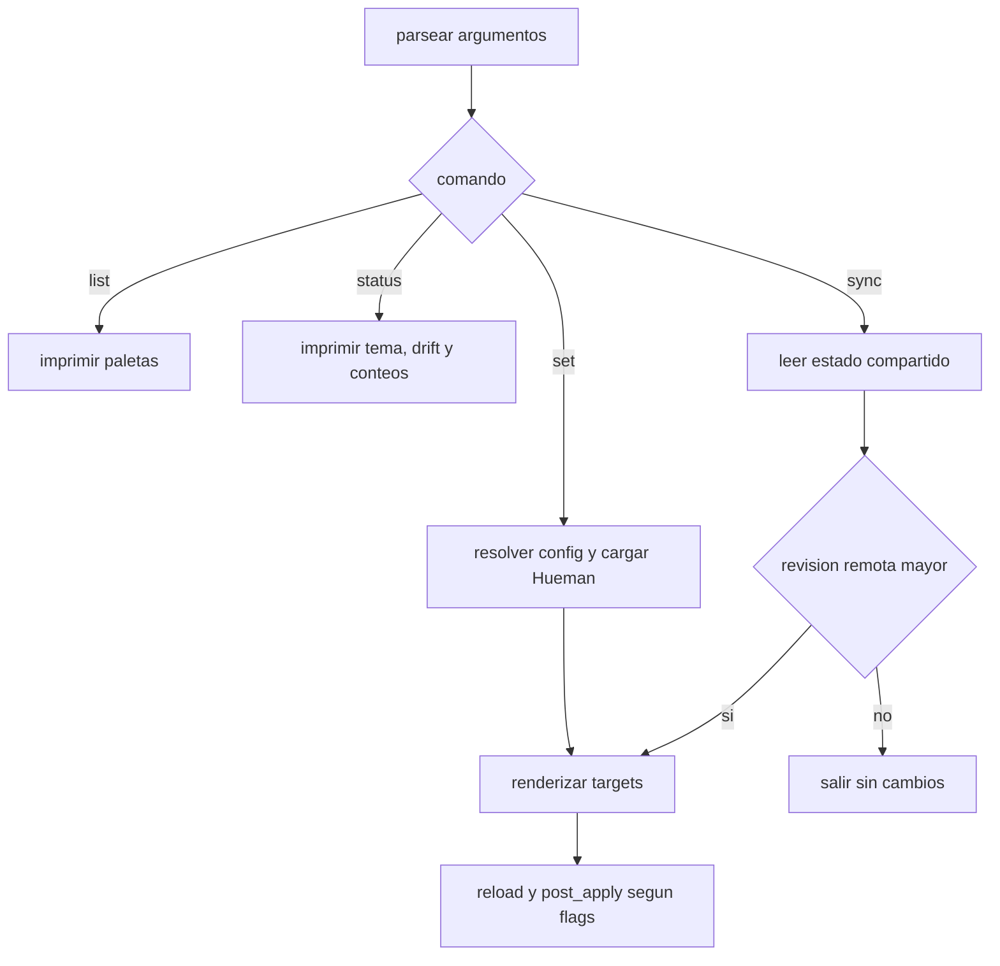

# CLI surface

La CLI de `hueman.py` es la interfaz operativa del motor: resuelve el archivo de configuración, carga paletas y targets, y expone cuatro comandos de usuario: `set`, `list`, `status` y `sync`. El comportamiento relevante está definido por el propio script y por los tests de integración que fijan cómo se propagan los flags, cómo se manejan los fallos y qué estado persiste entre ejecuciones.

## Punto de entrada y resolución de config

`main()` construye un `argparse` con una opción global `--config` y subcomandos. Antes de ejecutar cualquier acción, resuelve la ruta efectiva del config con `HuemanConfig.resolve_path(args.config)`, comprueba que exista y luego crea `Hueman(HuemanConfig(config_path))`. Si el archivo no existe o la configuración es inválida, imprime un error en `stderr` y sale con código 1.

La precedencia observada para la ruta es:

1. `--config RUTA`
2. `HUEMAN_CONFIG`
3. `./hueman.config.yaml` en el directorio actual
4. `~/.config/hueman/config.yaml`

Ese orden se documenta también en la página de configuración y está cubierto por tests de resolución de ruta.

## Comandos

### `set`

`set <paleta>` aplica una paleta por nombre. El flujo es:

1. cargar la paleta;
2. seleccionar targets;
3. renderizar cada target;
4. ejecutar su `reload` cuando realmente se escribió algo;
5. ejecutar `post_apply` al final, salvo que se trate de un `--only`.

Si un target falla al renderizar por falta de datos requeridos, se omite con warning y el resto continúa. El comando devuelve salida no nula si hubo fallos que el código considera fatales o si alguna selección de targets es inválida.

#### `--dry-run`

`--dry-run` deja intactos los archivos y el state file. En ese modo el motor solo simula el render y, si hay `post_apply`, imprime los comandos ya expandidos con el prefijo `[DRY RUN] post_apply:` en vez de ejecutarlos.

`--dry-run` también evita publicar estado compartido cuando `state_sync` está configurado.

#### `--only`

`--only` limita `set` a un subconjunto de targets. El flag es repetible y cada valor admite una lista separada por comas; el CLI aplana ambas formas antes de pasarlas al motor. Por ejemplo, `--only a,b --only c_*` se convierte en `['a', 'b', 'c_*']`.

El selector usa coincidencia tipo `fnmatch` contra el nombre del target:

- si no hay ningún target que coincida con un patrón, el comando falla con `UnknownTargetError` y lista los nombres válidos;
- si hay coincidencias, solo se renderizan esos targets y solo se ejecutan sus `reload`;
- en ese modo no se escribe el state file, no corre `post_apply` y no se publica estado compartido.

### `list`

`list` imprime las paletas disponibles, una por línea. Es una operación de solo lectura: no toca el state file, no escribe outputs y no dispara `reload`.

### `status`

`status` resume el estado visible del sistema:

- tema activo leído desde el `state_file`, o `(ninguno)` si el archivo no existe;
- estado de drift si `state_sync` está configurado;
- lista de paletas disponibles;
- recuento de targets configurados y cuántos outputs existen en disco.

Cuando `state_sync` está activo, `status` muestra además la revisión local y remota y clasifica el drift como `in sync`, `behind`, `ahead`, `no remote state` o `remote unreachable`.

### `sync`

`sync` lee el estado compartido y, si la revisión remota es más nueva, aplica esa paleta sin publicar una revisión nueva. Si no hay config de sincronización, si el backend es inalcanzable o si no hay estado remoto, el comando termina con código 0 y solo informa la condición.

Si la revisión remota es más nueva, `sync` llama internamente a `set_theme(..., publish=False)`, lo que aplica la paleta localmente pero evita re-publicarla.

## Reglas de operación relevantes

- `set` crea el directorio padre del `state_file` antes de escribirlo.
- El `state_file` contiene solo el nombre de la paleta activa, una línea por estado.
- El estado compartido usa un archivo `*.revision` al lado del `state_file` para recordar la última revisión local aplicada o publicada.
- Los comandos `reload` y `post_apply` se ejecutan de forma best-effort: un fallo de un comando no aborta automáticamente los siguientes pasos.

## Flags y efectos observables

### `-q/--quiet`

`-q/--quiet` solo existe para `sync`. Baja el logger a `ERROR`, de modo que se silencian avisos de configuración o red y solo quedan errores reales.

### `--config`

`--config` no modifica el contenido del config; solo selecciona qué archivo se carga. Si la ruta indicada no existe, la CLI falla antes de intentar cargar paletas o targets.

## Flujo de comandos

La secuencia anterior resume el control de alto nivel: `list` y `status` son observadores, `set` escribe y `sync` decide si reutiliza la misma ruta de render para ponerse al día con un estado compartido.

## Relación con otros conceptos

- La resolución del archivo de configuración se detalla en [Modelo de configuración](../concepts/configuration.md).
- El estado compartido y su semántica de revisión se explican en [State sync](../concepts/state-sync.md).
- El render de targets y los modos de escritura se cubren en [Targets and rendering](../concepts/targets-and-rendering.md).

## Tests que fijan el contrato

Los tests más útiles para esta superficie son:

- `tests/test_colors_and_cli.py::test_cli_only_flag_is_repeatable_and_comma_separated` — `--only` acepta repetición y comas.
- `tests/test_colors_and_cli.py::test_cli_only_unknown_exits_nonzero` — un patrón sin coincidencias provoca fallo y lista targets válidos.
- `tests/test_state_and_reload.py::test_cli_end_to_end_in_subprocess_uses_only_temp_paths` — el flujo `set`/`status`/`list` funciona en subprocess y respeta rutas temporales.
- `tests/test_state_and_reload.py::test_cli_missing_config_exits_one` — una ruta de config inexistente termina con exit 1.
- `tests/test_colors_and_cli.py::test_set_theme_dry_run_does_not_persist_state` y `tests/test_state_and_reload.py::test_dry_run_never_writes_state` — `--dry-run` no persiste el tema.
- `tests/test_colors_and_cli.py::test_set_theme_only_renders_matched_targets_skips_state_and_post_apply` — `--only` evita state file y `post_apply`.
- `tests/test_state_and_reload.py::test_status_reports_active_theme_palettes_and_target_counts` — `status` muestra tema activo, paletas y recuento de outputs.

Estos tests son los que más claramente establecen el contrato observable de la CLI: selección explícita de config, modos de render, y diferencias entre escritura completa, previsualización y sincronización.
