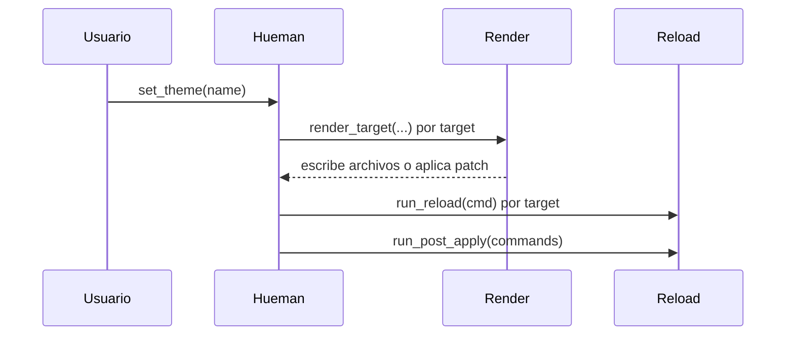

# Templates and hooks integration

Esta página documenta cómo el motor de integración toma una paleta activa, construye el contexto de Jinja2, renderiza templates, y luego ejecuta hooks de recarga por target y comandos globales `post_apply`.

Se conecta con el modelo general de targets y render en [Targets and rendering](../concepts/targets-and-rendering.md) y con el manejo operacional de fallos en [Runtime and failure handling](../operations/runtime-and-failure-handling.md).

## Panorama del flujo

El flujo normal es:

1. Se carga la configuración y se elige una paleta activa.
2. El render construye un `jinja2.Environment` compartido para todos los targets.
3. Cada target prepara su contexto desde la paleta y renderiza su template o aplica un patch.
4. Si el target define `reload`, ese comando se ejecuta después de escribir el target, de forma best-effort.
5. Al final de `set`, los comandos globales `post_apply` se ejecutan una sola vez.

El diagrama resume el orden observable: primero se materializan los targets, luego se disparan los hooks de recarga, y finalmente los `post_apply` globales.

## Jinja2 y contexto de render

El motor crea el entorno Jinja2 con [`make_jinja_env`](../../engine/render.py) y usa un `ChoiceLoader` con dos capas:

- `template_dirs` configurados por el usuario.
- el directorio empaquetado de templates del proyecto.

La búsqueda favorece primero los templates del usuario, así que un nombre personalizado puede reemplazar a uno empaquetado sin cambiar el código del target.

El contexto de cada render se arma en `build_context`:

- siempre incluye `theme_name`;
- si el target define `palette_key` y esa clave existe, se inyecta ese subárbol de la paleta;
- `extra_vars` permite exponer claves adicionales por lookup con ruta punteada, por ejemplo `foo.bar.baz`.

Si una ruta punteada no existe, el render falla con un error de clave, porque el template depende de un dato que no está presente en la paleta activa.

## Filtros de color: `contrast` e `is_dark`

El módulo `engine/colors.py` expone dos filtros Jinja globales:

- `contrast`: devuelve un texto casi negro o casi blanco según la luminancia relativa WCAG del color de fondo.
- `is_dark`: usa el mismo criterio, pero devuelve un booleano.

Ambos filtros se registran en el entorno Jinja2 de todos los templates, no sólo en un target concreto. Esto permite que cualquier template derive texto legible o decida si una paleta debe declararse como oscura.

La decisión de color se basa en la luminancia relativa del hex recibido:

- valores claros producen `#1a1a1a` como texto de contraste;
- valores oscuros producen `#f5f5f5`;
- `is_dark` devuelve `true` para el mismo umbral que dispara el texto claro.

## Delimitadores alternativos

`make_jinja_env` acepta `delimiters` para cambiar `variable_start_string` y `variable_end_string`.

Eso sirve cuando el template destino ya usa `{{ ... }}` por otro lenguaje o formato, y se necesita evitar colisiones con Jinja2. El comportamiento por defecto sigue siendo el de Jinja2 estándar si no se pasan delimitadores alternativos.

## Expansión de placeholders en hooks

Los comandos de `reload` y `post_apply` no se ejecutan como literales puros: antes de invocarlos, `expand_command` expande ciertos placeholders y los protege con quoting de shell.

### Qué placeholders se expanden

Se sustituyen estos patrones:

- `{name}`: el nombre de la paleta activa.
- `{palette}`: alias del nombre de la paleta activa.
- `{a.b}`: lookup punteado dentro de la paleta activa, usando `_dig`.

El valor interpolado se pasa por `shlex.quote`, así que espacios o caracteres especiales quedan escapados de forma segura para `sh -c`.

### Qué no se expande

El motor preserva sin tocar:

- `${VAR}` del shell, gracias al lookbehind que evita match si la llave va precedida por `$`.
- llaves literales sin punto, como `find -exec {} +`, salvo que sean `{name}` o `{palette}`.
- texto de shell o plantilla que no coincida con el patrón de placeholder.

### Cuándo un placeholder es error

Si aparece un placeholder punteado como `{kitty.nope}` y `_dig` no puede resolverlo, `expand_command` lanza `ValueError`.

Eso es intencional: un hook con una ruta de datos inválida no se ejecuta silenciosamente con un comando incompleto.

## Ejecución de `reload`

`run_reload` ejecuta un comando por target y devuelve su código de salida.

Propiedades importantes:

- si el target no define comando, devuelve `0`;
- si el comando existe, se invoca vía `sh -c`;
- el resultado se registra con el label `reload`.

La semántica es best-effort: la recarga no reemplaza al render, sino que lo sigue. Un fallo de reload no borra el archivo ya escrito; sólo informa el código de salida.

## Ejecución de `post_apply`

`run_post_apply` recibe una lista de comandos y los ejecuta uno por uno.

Semántica:

- cada comando se ejecuta aunque uno anterior falle;
- la función devuelve la lista de pares `(command, exit_code)` para los comandos no exitosos;
- el hook global se invoca una sola vez al final del `set`, no por target.

Esto permite concentrar acciones finales, como notificaciones, reinicios suaves o sincronización de estado, sin acoplarlas al ciclo de cada target.

## Invariantes y fallos relevantes

### Render

- Si falta `palette_key` en la paleta activa, `render_overwrite` y `render_patch` regresan `False` y el target se omite.
- Si falta una clave requerida por `extra_vars`, el render falla con un error de clave y no genera salida parcial.
- Si el template no existe, `render_target` lo convierte en `TargetRenderError` con una explicación explícita.
- Los errores de E/S también se envuelven como `TargetRenderError`.

### Patch

El modo `patch` soporta dos estrategias visibles en el motor:

- `regex_splice` para reemplazar o insertar bloques delimitados por regex o marcadores literales;
- `json_scheme_upsert` para actualizar o agregar un esquema dentro de un JSON existente.

En `json_scheme_upsert`, si el archivo no es JSON válido, el render falla con `TargetRenderError`.
En `regex_splice`, si el archivo destino no existe o su padre no existe cuando `skip_if_missing_parent` lo exige, el target se omite.

### Hooks

- `run_reload` y `run_post_apply` dependen de `sh -c`; el contenido final debe tratarse como comando de shell.
- La expansión de placeholders ocurre antes de invocar el shell, pero los valores sustituidos se citan con `shlex.quote`.
- Un placeholder desconocido en una ruta punteada detiene el hook con error explícito.

## Tests que importan

Los tests del repositorio muestran las garantías más importantes de esta integración:

- `tests/test_colors_and_cli.py` verifica que `contrast_text` e `is_dark` clasifiquen valores claros y oscuros, y que `post_apply` se ejecute después de persistir estado.
- El mismo archivo prueba que `only` limita qué targets se renderizan y que los reloads asociados también quedan filtrados.
- `tests/test_command_substitution.py` cubre la expansión de `{name}`, `{palette}` y lookups punteados, el quoting seguro, la preservación de `${HOME}` y `{}` literales, y el error de un placeholder punteado inexistente.

En conjunto, estos tests fijan la interfaz observable: render con contexto completo, hooks seguros frente a shell injection accidental, y fallos explícitos cuando la configuración o la paleta no contienen lo que un template necesita.
