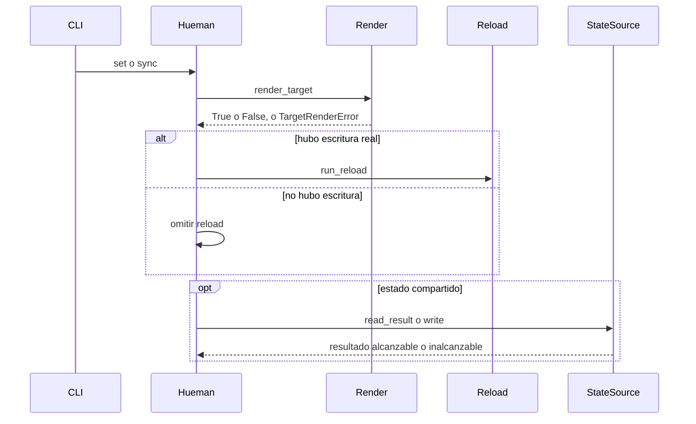
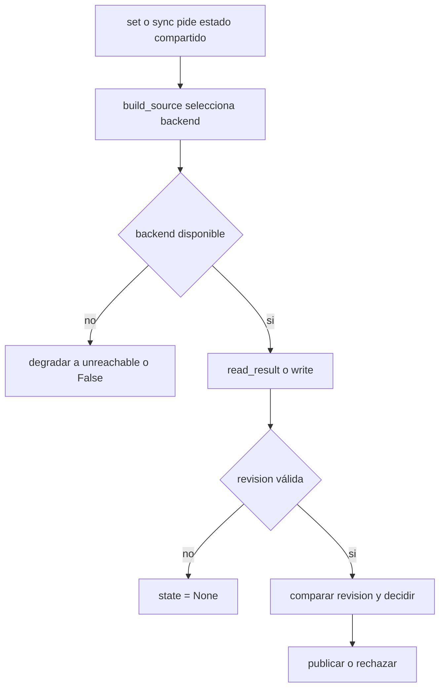

# Runtime and failure handling

Esta página centraliza cómo hueman se comporta cuando algo falla durante `set`, `sync` o la publicación del estado compartido. La idea rectora es simple: **seguir aplicando localmente cuando sea seguro, acotar el tiempo de espera y no tocar el working tree del usuario**.

## Capas y responsabilidades

El manejo de fallos se reparte por capas:

- **CLI / orquestación**: decide el exit status global de `set` y `sync`, imprime errores de nivel de operación y evita que un fallo de backend bloquee una acción local válida.
- **Render**: transforma targets declarativos en archivos y distingue entre omisión, fallo limpio del target y escritura exitosa.
- **Reload**: ejecuta comandos de `reload` por target y `post_apply` globales, registrando su exit code sin abortar el resto del trabajo.
- **StateSource**: encapsula el estado compartido detrás de una interfaz con resultados alcanzables/inalcanzables y tiempo acotado.

El diagrama resume la regla práctica: render primero, reload solo si hubo escritura, y el estado compartido nunca debe convertir un arranque del shell en una falla dura si el backend no está disponible.

## Políticas de `reload` y `post_apply`

`engine/reload.py` trata los comandos como procesos externos y registra su código de salida.

- `run_reload(cmd, logger)` devuelve el exit code del comando; si `cmd` está vacío, devuelve `0`.
- `run_post_apply(commands, logger)` ejecuta todos los comandos y devuelve solo los que fallaron; un fallo no detiene los demás.
- ambos usan `sh -c` y dejan el detalle del comando en el log.

La política observada por `Hueman.set_theme(...)` es:

- un `reload` de target solo corre si ese target realmente escribió al menos una salida;
- `post_apply` corre una sola vez al final de un `set` completo, nunca en `--only`;
- `--dry-run` no ejecuta ni `reload` ni `post_apply`, solo imprime lo que se haría.

## `reload_failure`: warning vs error

`reload_failure` define si un `reload` fallido se considera advertencia o error. La política puede venir de dos lugares:

- la política global `reload_failure` del config;
- la política específica del target, que sobreescribe la global.

Comportamiento observable:

- con `warn`, un `reload` que sale distinto de `0` se registra como warning y `set` sigue con exit `0`;
- con `error`, el fallo se registra como error, el resto del flujo sigue en modo best-effort, y `set` termina con exit `1`;
- `post_apply` usa la política global; si falla bajo `error`, también fuerza exit `1`.

Esa separación es importante: el motor no revierte lo ya escrito ni corta los targets restantes solo porque una recarga individual falló.

## Escritura y fallos de E/S

La capa de render usa escritura atómica y evita dejar basura temporal.

- `overwrite` crea el directorio padre si hace falta y escribe con `atomic_write_text`.
- `patch` lee el archivo existente, calcula el contenido nuevo y también termina en escritura atómica cuando corresponde.
- `skip_if_missing_parent` y `skip_unless_path_exists` permiten omitir targets o salidas sin tratar la omisión como error.
- si una escritura falla por permisos, disco lleno u otro `OSError`, el target falla de forma limpia y el archivo original queda intacto.

El comportamiento de `render_target(...)` separa bien los casos:

- `True` cuando hubo al menos una salida escrita;
- `False` cuando el target se omitió por guardas o por falta de datos requeridos;
- `TargetRenderError` cuando hay un problema material del target, como plantilla faltante, JSON inválido, clave ausente o error de E/S.

## Estado compartido: `StateSource` y degradación segura

La sincronización de estado usa la interfaz `StateSource`, no un backend concreto. Eso permite que el motor trate de leer o publicar estado sin conocer si detrás hay `git` o `file`.

El contrato operativo es:

- no lanzar hacia el llamador ante fallos de backend;
- mantener cada operación dentro de un límite de tiempo;
- respetar `revision` como entero monótono: gana la revisión mayor y, en empate, la escritura aceptada al final.

### Backend `git`

El backend `git` publica el estado en la rama huérfana `hueman-state` usando un repositorio privado bajo el área de estado del usuario. Ese repo de estado es independiente del repo de dotfiles, y el working tree del usuario no se modifica.

Puntos operativos importantes:

- si `git` no está disponible, el backend se deshabilita con warning;
- si el remoto no existe o no se puede alcanzar, `read_result()` devuelve `remote=False`;
- si la revisión remota es mayor, `write()` rechaza publicar el estado más viejo;
- las llamadas de git tienen timeout acotado (`GIT_TIMEOUT`, 15 s por defecto);
- la comunicación por SSH se configura en modo no interactivo (`BatchMode=yes`) para no colgar el shell.

### Backend `file`

El backend `file` usa un YAML `{palette, revision}` en una ruta compartida por otra herramienta de sincronización.

- la escritura es atómica;
- si la carpeta padre no existe, se trata como inalcanzable y no se crea;
- `read_result()` distingue entre alcanzable pero vacío e inalcanzable;
- no hay bloqueo distribuido, así que la conciliación final sigue la regla de `revision`.

## `sync`, `status` y códigos de salida

`sync` está pensado para poder ejecutarse en el arranque del shell sin ser molesto.

- si `state_sync` no está configurado, `sync` avisa y sale con `0`;
- si el backend es inalcanzable, `sync` sale con `0` y no aplica caché local como si fuera estado remoto;
- si el estado remoto no existe, también sale con `0`;
- solo cuando el remoto es más nuevo intenta aplicar la paleta y, si el render falla, `sync` devuelve `1`.

`status` usa la misma información para mostrar drift:

- `in sync`
- `behind`
- `ahead`
- `no remote state`
- `remote unreachable`

## Invariantes operativas

- un fallo de estado compartido no debe romper la aplicación local de temas;
- un fallo de recarga no debe impedir que otros targets sigan ejecutándose;
- `set` no debe escribir el state file en `--only` ni en `--dry-run`;
- la publicación del estado compartido es best-effort y nunca debe tocar el working tree del usuario;
- todo bloqueo de red o backend tiene que estar acotado por timeout.

## Tests que fijan estas políticas

Las pruebas más importantes para esta página son las que verifican comportamiento observable:

- `tests/test_error_paths.py` cubre fallos de configuración, estados de palette inválidos y que un `set` con error preserve el estado previo.
- `tests/test_reload_exit_codes.py` verifica el exit code de `run_reload`, la política `warn` vs `error`, el comportamiento de `post_apply` y que una escritura fallida no altere el original.
- `tests/test_state_source_contract.py` fija el contrato de `StateSource`: lectura/escritura sin excepciones, monotonicidad de `revision`, empate por última escritura aceptada y degradación segura cuando el backend no está disponible.

En conjunto, estas pruebas sostienen la promesa principal del runtime: **degradar con seguridad, registrar el fallo correcto y conservar el control del usuario sobre su árbol de trabajo**.
