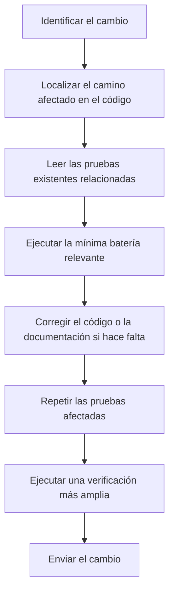
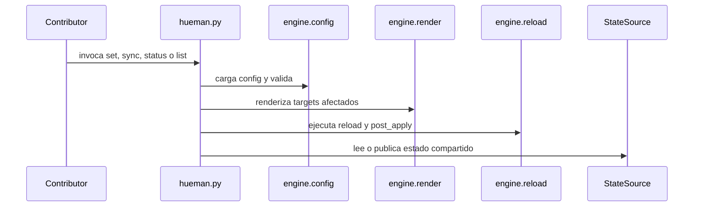

# Contributor workflow and verification

Esta página resume el flujo práctico para cambiar el sistema con seguridad: primero localizar la superficie afectada, luego ejecutar las pruebas relevantes y, al final, verificar que no aparezcan regresiones en los comportamientos que importan.

El principio guía es simple: usa el código y las pruebas del repositorio como fuente de verdad. Evita depender de rutas, variables o datos del entorno local que no queden modelados en el repo.

## Qué responsabilidad cubre este flujo

El proyecto tiene una separación bastante clara entre configuración, renderizado, recarga y sincronización de estado:

- `engine/config.py` carga `hueman.config.yaml` y valida la forma del sistema de configuración.
- `engine/palettes.py` resuelve paletas desde `palettes/` empaquetadas y directorios custom.
- `engine/render.py` materializa outputs mediante `render_overwrite` y `render_patch`.
- `engine/reload.py` ejecuta `reload` y `post_apply` como pasos best-effort.
- `engine/statesource.py` y `build_source` abstraen el backend de estado compartido.
- `hueman.py` coordina los comandos `list`, `status`, `set` y `sync`.

Para quien contribuye, la pregunta útil no es “qué archivo toqué”, sino “qué camino de ejecución cambia y qué prueba lo demuestra”.

## Flujo recomendado de trabajo



El flujo de trabajo recomendado para contribuir.

### 1. Identificar la superficie afectada

Empieza por el comando o mecanismo que se va a alterar:

- `set` si cambia el renderizado, la escritura de outputs o el manejo de `reload`.
- `sync` si cambia la reconciliación de estado, el drift o el comportamiento del backend.
- `status` si cambia la información que se reporta sobre estado local o remoto.
- `list` si cambia la resolución de paletas o la presentación del catálogo.

Después sigue los llamados hacia abajo hasta encontrar el punto de mutación real. En este repositorio, la mayor parte del comportamiento observable vive en los módulos `engine/`, no en wrappers del CLI.

### 2. Leer primero las pruebas, no solo la implementación

Las pruebas existentes describen invariantes que no conviene romper al modificar el sistema. En particular, fíjate en:

- `tests/test_render.py` para semántica de `overwrite`, `patch`, `dry-run`, preservación de contenido y estrategias de parcheo.
- `tests/test_state_and_reload.py` para estado actual, escritura de `state_file`, `status`, `reload`, `post_apply` y CLI end-to-end.
- `tests/test_error_paths.py` para errores de configuración, paletas inválidas y fallos de CLI sin traceback.
- `tests/test_state_source_contract.py` para el contrato de los backends de estado.

Leer primero la prueba ayuda a distinguir un cambio intencional de una regresión accidental.

### 3. Ejecutar la batería mínima relevante

Ejecuta el subconjunto de pruebas más cercano al cambio antes de lanzar la suite completa. Eso reduce ruido y hace más fácil interpretar fallos.

Ejemplos prácticos:

```sh
pytest tests/test_render.py
pytest tests/test_state_and_reload.py
pytest tests/test_error_paths.py
pytest tests/test_state_source_contract.py
```

Si el cambio toca solo un comportamiento muy concreto, puedes bajar todavía más el alcance y correr una prueba individual.

### 4. Repetir hasta cerrar la regresión

Cuando una prueba falla, no “arregles” alrededor del síntoma. Revisa el camino completo:

1. qué entrada produce el fallo,
2. qué rama de control toma el código,
3. qué supuesto de la prueba se dejó de cumplir,
4. qué invariantes deben mantenerse.

Luego ajusta la implementación o la prueba, según corresponda, y vuelve a ejecutar el subconjunto afectado.

### 5. Hacer una verificación más amplia antes de cerrar

Una vez que pasa la batería enfocada, ejecuta una verificación más amplia del área tocada para detectar regresiones laterales. El repo está pensado para que la señal importante venga de las pruebas, no del estado del entorno local.

## Invariantes que vale la pena revalidar

Hay varios comportamientos que las pruebas protegen y que suelen romperse cuando se cambia el flujo central:

- Un `set` exitoso debe actualizar el estado solo cuando corresponde; `--dry-run` y `--only` no deben escribirlo.
- Si un output se omite por configuración o por falta de directorio padre, el `reload` solo debe correr cuando al menos un output realmente se escribió.
- Un fallo de `reload` o `post_apply` no debe abortar el resto de los pasos por sorpresa; el sistema sigue con semántica best-effort.
- Un error de configuración o una paleta inválida debe fallar con salida limpia, no con traceback crudo.
- Los paths y artefactos temporales de verificación deben quedar confinados al repo o al sandbox de prueba.

## Cuándo mirar cada zona del código



Diagrama de alto nivel de las capas que conviene revisar al cambiar el flujo.

- Cambios de plantillas o destinos de salida: revisa `engine/render.py` y `tests/test_render.py`.
- Cambios de estado o drift: revisa `engine/statesource.py`, `hueman.py` y `tests/test_state_source_contract.py`.
- Cambios de CLI o códigos de salida: revisa `hueman.py`, `tests/test_state_and_reload.py` y `tests/test_error_paths.py`.
- Cambios de configuración: revisa `engine/config.py` y las pruebas de validación.

## Señales de que falta una prueba

Añade o ajusta pruebas cuando el cambio modifica una de estas cosas:

- el orden de los pasos,
- si algo se escribe o no se escribe,
- cuándo se ejecuta una recarga,
- cómo se propagan los errores,
- qué salida espera el usuario por CLI,
- qué backend de estado se elige o cómo se resuelve un conflicto.

Si el cambio altera un comportamiento que un lector podría reproducir desde el repo, debería quedar cubierto por una prueba enfocada.

## Buenas prácticas al verificar

- Usa rutas temporales creadas por las propias pruebas o por `tmp_path`.
- Prefiere comandos del propio repositorio antes que supuestos sobre el sistema anfitrión.
- Mantén el alcance de la primera pasada pequeño y documentable.
- Si un fallo solo aparece en una integración más amplia, deja claro qué prueba lo detecta y por qué.

## Relación con otras guías

- [Quickstart](../quickstart.md) para levantar el proyecto y entender el uso básico.
- [Overview](../testing/overview.md) para el mapa general del área de testing.
- [Runtime and failure handling](../operations/runtime-and-failure-handling.md) para los comportamientos operativos que conviene revalidar cuando cambian errores o recuperación.

En resumen: localiza la ruta, valida con las pruebas que describen esa ruta, y solo después amplía la verificación al resto del sistema.