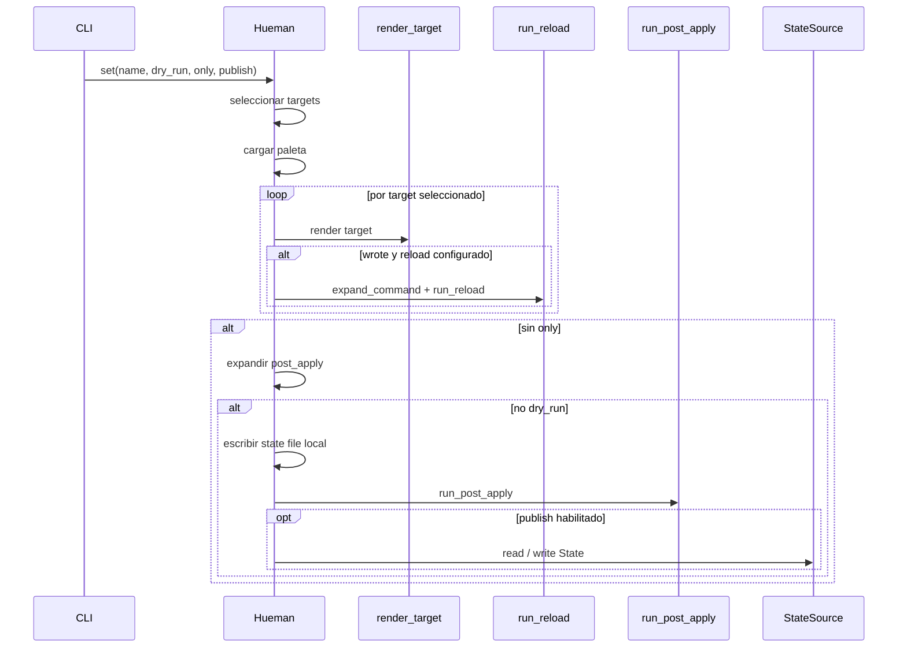

# Apply theme workflow

`set` es el flujo principal de aplicación de un tema. Toma una paleta, renderiza los targets configurados, ejecuta recargas por target cuando corresponde, persiste el tema activo en el state file local, ejecuta `post_apply` globales y, si está habilitado, publica el estado compartido.

La idea clave es que el renderizado y las recargas de cada target se hacen de forma independiente y best-effort: un fallo en un target no detiene a los demás. En cambio, la persistencia del tema activo y la publicación compartida se consideran pasos de cierre del cambio completo.

## Orden exacto de operaciones

Cuando se invoca `set <name>` sin `--only`, el flujo es este:

1. Se seleccionan los targets configurados.
2. Se carga la paleta `<name>`.
3. Para cada target seleccionado, en orden de configuración:
   1. Se construye el entorno Jinja2 del target.
   2. Se renderiza el target.
   3. Si el render no produce escrituras, no hay reload para ese target.
   4. Si el render escribe archivos y el target tiene `reload`, se expande el comando y se ejecuta el reload.
   5. Si el reload falla, se registra según la política `reload_failure` del target o la global, pero el resto del flujo continúa.
4. Si no hubo `--only`:
   1. Se expanden los comandos globales `post_apply`.
   2. En `--dry-run`, se imprimen los `post_apply` y el flujo termina sin escribir estado local ni publicar.
   3. Sin `--dry-run`, se escribe el state file local con el nombre del tema.
   4. Se ejecutan los `post_apply` una sola vez, en serie, sin abortar al primer fallo.
   5. Si la publicación compartida está habilitada, se intenta publicar el estado.

## Qué se salta con `--dry-run`

`--dry-run` conserva el orden lógico del flujo, pero evita efectos secundarios:

- no escribe archivos de salida;
- no ejecuta reloads reales;
- no escribe el state file local;
- no ejecuta `post_apply` reales;
- no publica estado compartido.

Sí se sigue haciendo el cálculo del render para poder detectar qué se habría escrito y qué comandos se habrían disparado.

## Qué se salta con `--only`

`--only` convierte `set` en una re-renderización parcial. Solo se aplican los targets que coinciden con los patrones dados y solo se ejecutan sus reloads.

Con `--only`:

- no se escribe el state file local;
- no se ejecutan `post_apply`;
- no se publica estado compartido;
- el resultado se usa como una actualización parcial, no como un cambio de tema completo.

Si ningún patrón coincide, el comando falla con `UnknownTargetError` antes de renderizar nada.

## Retries y semántica de fallos

Los fallos importantes del flujo se tratan por capas:

- Si una plantilla, una clave requerida de la paleta o la E/S del render falla, el target se omite y se reporta como fallo del target.
- Si un reload devuelve un código distinto de cero, el comportamiento depende de `reload_failure`:
  - `warn`: se registra y el flujo continúa;
  - `error`: el target o `post_apply` fallido se marca como fallo.
- Si falla un `post_apply`, los demás siguen ejecutándose.
- La publicación compartida es best-effort: cualquier error interno se degrada a advertencia y no rompe `set`.

Esa separación evita que una herramienta individual bloquee la aplicación del resto del tema.

## Publicación compartida del estado

Después de aplicar localmente el tema, `set` puede publicar el estado compartido a través del `StateSource` configurado. La publicación usa la revisión local o remota más alta como base y escribe `State(name, revision+1)`; si la escritura no se confirma, el tema sigue aplicado localmente.

La publicación comparte el nombre de la paleta activa, no el contenido renderizado. El contenido renderizado ya quedó materializado en los targets locales antes de este paso.

## Secuencia resumida

El diagrama muestra el orden de alto nivel; los detalles de cómo se resuelven paletas, targets y estado compartido se documentan en las páginas conceptuales relacionadas.

## Puntos de extensión relevantes

- Los targets determinan qué se renderiza, dónde se escribe y qué reload se dispara.
- `reload_failure` permite cambiar si un fallo de recarga solo avisa o marca error.
- `post_apply` introduce acciones globales posteriores al cambio completo.
- `state_sync` define cómo se publica y sincroniza el estado compartido.

## Pruebas que fijan el comportamiento

Las pruebas cubren los invariantes más importantes del flujo:

- dos ejecuciones completas de `set` sobre el mismo tema no cambian los archivos resultantes;
- un reload fallido no aborta la escritura del estado ni el resto del flujo cuando la política lo permite;
- `--dry-run` no escribe el state file;
- `--only` no actualiza el state file ni ejecuta `post_apply`;
- `post_apply` se ejecuta completo aunque una entrada falle;
- la publicación compartida es best-effort y no rompe `set`.

## Relación con otras páginas

- [State sync](../concepts/state-sync.md): semántica del `StateSource`, lectura/escritura y publicación remota.
- [Targets and rendering](../concepts/targets-and-rendering.md): cómo se construyen los targets, el contexto de render y las salidas.
- [Runtime and failure handling](../operations/runtime-and-failure-handling.md): políticas de error, códigos de salida y degradación segura.
